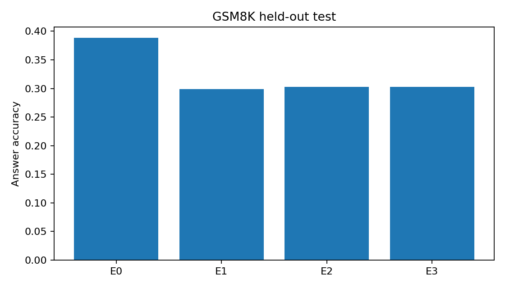
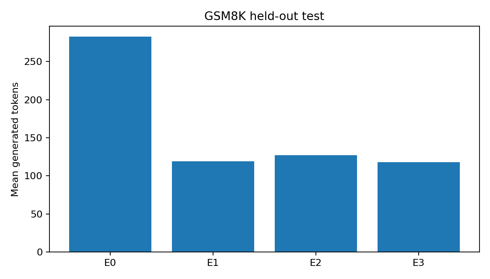
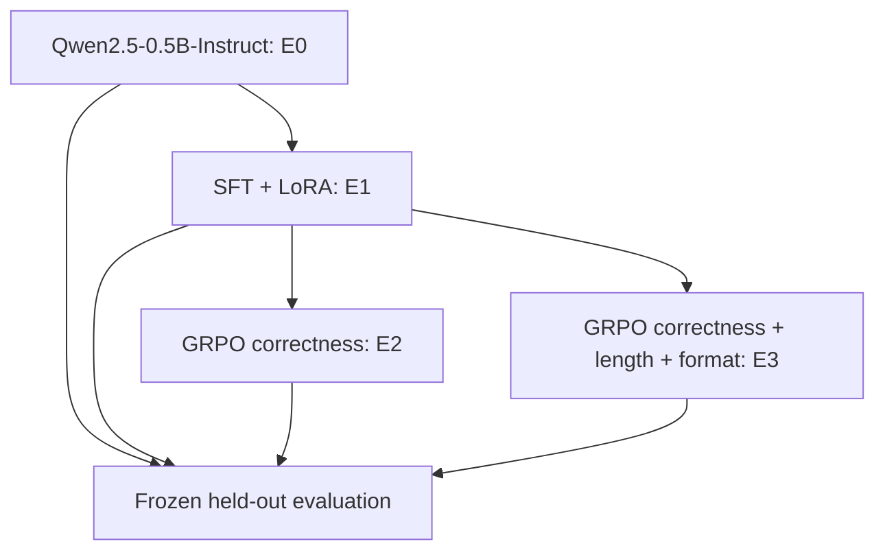

# ReasonLite

**Accuracy–efficiency trade-offs in resource-constrained LLM post-training**

  

A reproducible empirical study of Qwen2.5-0.5B-Instruct, completion-only SFT with LoRA, and two GRPO reward designs. The objective is to measure the cost of concise mathematical answers, not to claim a novel algorithm or a superior general-purpose model.

**Result:** SFT cut mean output length by **57.78%** and increased correct answers per generated token by **1.82×**, while reducing answer accuracy by **8.95 percentage points** on the official GSM8K test set. Neither exploratory GRPO arm significantly improved accuracy over SFT. All four checkpoints and both favorable and unfavorable results are retained.

## Results: held-out official GSM8K test (n=1,319 per arm)

| Arm | Correct / 1,319 | Accuracy (95% Wilson CI) | Mean tokens | Correct / 1k tokens | Format | Questions/s |
|---|---:|---:|---:|---:|---:|---:|
| E0 | 512 | 38.82% (36.22%–41.48%) | 282.54 | 1.374 | 0.00% | 1.559 |
| E1 | 394 | 29.87% (27.46%–32.40%) | 119.28 | 2.504 | 94.92% | 1.364 |
| E2 | 399 | 30.25% (27.83%–32.78%) | 127.15 | 2.379 | 93.63% | 1.324 |
| E3 | 399 | 30.25% (27.83%–32.78%) | 117.80 | 2.568 | 93.78% | 1.450 |




E1 was chosen as the primary efficiency candidate on development data. E3 has the highest observed test token-efficiency ratio but is not retroactively selected as the primary model. Batched throughput was lower for the adapted models; token efficiency is **not** a measured inference speedup. Confidence intervals describe question-level uncertainty, not variation across training seeds.

## Experimental design



- One Tesla T4; 1,081,344 trainable parameters out of 495,114,112 (0.2184%).
- Seed 42; 512 SFT, 256 RL pool (64 used per arm), 128 development validation and all 1,319 official test questions.
- Four completions per RL prompt, 512 total rollouts across E2/E3; independent branches from identical E1 weights.
- Frozen model/dataset revisions and evaluator/scorer checksums; six paired exact McNemar tests with Holm adjustment.

## Verify the evidence locally (no GPU or model download)

```bash
python -m unittest discover -s tests -v
python -m scripts.audit_evidence
```

This recomputes scoring, metrics, pairing and reward diagnostics from stored outputs; checks dataset, adapter and protocol hashes; and checks finite saved adapter tensors. It does not replay model generation or training. See [reproduction](docs/REPRODUCIBILITY.md) for GPU commands and [provenance](docs/PROVENANCE.md) for the difference between executed code and release maintenance.

## Repository map

| Path | Purpose |
|---|---|
| `reasonlite/` | Data, SFT, GRPO, scoring, evaluation and statistics |
| `data/prepared/` | Frozen benchmark splits and manifest |
| `runs/` | Validation, model adapters, rollouts and complete held-out evidence |
| `runs/final_v1/report/` | Original generated report, CSVs, figures and JSON |
| `docs/RESEARCH_REPORT.md` | Technical report and interpretation |
| `docs/PROTOCOL.md` | Methods and experimental design |
| `docs/ERROR_ANALYSIS.md` | Failures, limitations and follow-up work |
| `docs/MODEL_CARD.md` | Adapter locations, loading and limitations |
| `docs/REPRODUCIBILITY.md` | CPU audit and fresh-run commands |
| `notebooks/Review.ipynb` | Lightweight evidence review |
| `provenance/` | Historical notebooks and executed source |
| `halo_native/` | Prepared native Halo recipe; **not executed** |
| `tests/`, `.github/workflows/` | Offline regression and evidence checks |

## Status and intended use

Research prototype, not a production math tutor or a claim of mathematical reasoning fidelity. One seed, one base model and one benchmark. E3 recorded a nonfinite gradient; final adapter weights were finite. Raw results are retained. The prepared Halo recipe is separate, not an executed native experiment. QLoRA was not run. Read [limitations](docs/ERROR_ANALYSIS.md), [contribution review](docs/CONTRIBUTIONS.md) and [third-party terms](docs/THIRD_PARTY.md) before sharing. No project-wide open-source license has been selected; private reviewer access is the default pending owner review.
