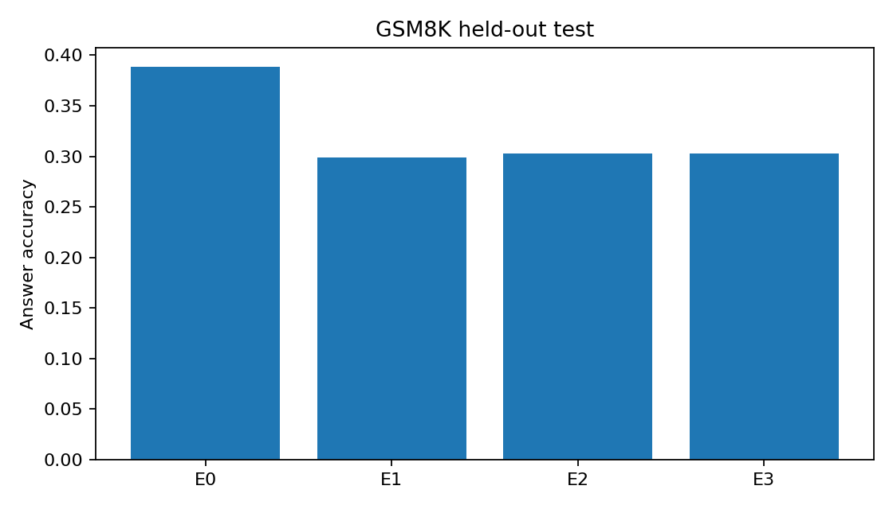
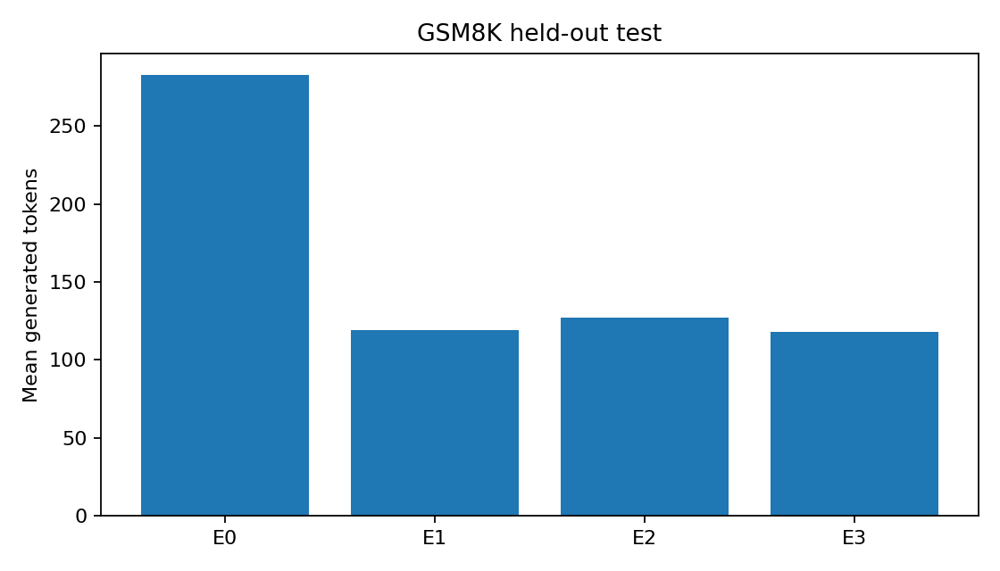
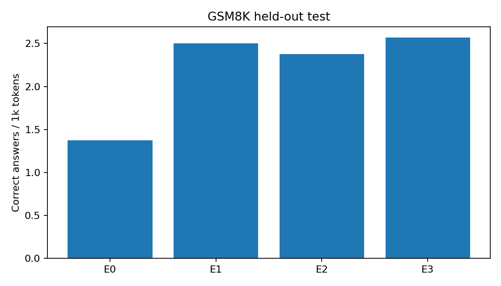

# ReasonLite: Accuracy–efficiency trade-offs in resource-constrained LLM post-training

**Technical research report · exploratory single-seed study · November 2026**

## Abstract

We investigate post-training of Qwen2.5-0.5B-Instruct under a single-GPU budget. Four frozen checkpoints are compared: original model, completion-only SFT with LoRA, and correctness-only and efficiency-shaped GRPO initialized from the same supervised adapter. On 1,319 official GSM8K test questions, the supervised checkpoint reduces average generated tokens from 282.54 to 119.28 and raises correct answers per 1,000 tokens from 1.374 to 2.504. Answer accuracy falls from 38.82% to 29.87% (Holm-adjusted paired p=6.47e-8). Both GRPO variants reach 30.25%, without significant improvement over SFT. Rollout diagnostics reveal sparse relative reward signals; one efficiency-arm gradient is nonfinite. The results expose a token-efficiency versus answer-accuracy trade-off, not an algorithmic advance or universal conclusion.

## 1. Motivation and related work

Small models are attractive for limited-memory systems, but post-training may trade mathematical accuracy for concise, structured answers. LoRA adapts low-rank weight updates (Hu et al., 2021); GRPO uses relative group rewards (Shao et al., 2024). GSM8K (Cobbe et al., 2021) provides grade-school mathematical word problems. This project uses established methods; its contribution is a transparent, bounded comparative experiment and failure analysis. It does not assert novelty in reward shaping or comprehensively survey related work.

## 2. Methods

E0 original Qwen; E1 LoRA SFT on 512 examples; E2/E3 independent GRPO arms using 64 identical RL prompts and four completions per prompt. Training and validation split IDs are disjoint. Both RL arms share parent adapter, seed and configuration; only reward changes. E3 adds bounded length penalty and strict-format bonus to correct answers. Full configurations and revision hashes are in [protocol](PROTOCOL.md). Training used one Tesla T4, 1,081,344 trainable parameters (0.2184%). SFT took 186.43 s and peaked at 2716.85 MiB allocated. RL durations 747.61 and 701.34 s; both approximately 4 GiB peak allocation. Times exclude setup and evaluation.

## 3. Development results (batch-one)

| Arm | Accuracy | Mean tokens | Format rate | Correct / 1k tokens |
|---|---:|---:|---:|---:|
| E0 | 53.91% | 266.31 | 0.00% | 2.024 |
| E1 | 50.00% | 117.75 | 94.53% | 4.246 |
| E2 | 49.22% | 125.78 | 92.19% | 3.913 |
| E3 | 45.31% | 120.48 | 93.75% | 3.761 |

E1 selected as efficiency candidate before final test. Scorer v2 was corrected using development predictions to support explicit final answers beyond strict markers. The revised scorer was applied consistently and locked before held-out evaluation.

## 4. Held-out results (batch 16)

| Arm | Correct / 1,319 | Accuracy (95% Wilson CI) | Mean tokens | Correct / 1k tokens | Format | Questions/s |
|---|---:|---:|---:|---:|---:|---:|
| E0 | 512 | 38.82% (36.22%–41.48%) | 282.54 | 1.374 | 0.00% | 1.559 |
| E1 | 394 | 29.87% (27.46%–32.40%) | 119.28 | 2.504 | 94.92% | 1.364 |
| E2 | 399 | 30.25% (27.83%–32.78%) | 127.15 | 2.379 | 93.63% | 1.324 |
| E3 | 399 | 30.25% (27.83%–32.78%) | 117.80 | 2.568 | 93.78% | 1.450 |

E1 has 57.78% fewer output tokens and 1.82× correct answers per generated token relative to E0, with 118 fewer correct answers. Format compliance is 94.92%, versus 0% for E0. E3 has the highest observed token efficiency but not the preselected primary candidate. All adapted models have lower measured batched throughput than E0; fewer output tokens should not be equated with lower wall-clock latency. See CSVs for exact values and memory.

## 5. Statistical comparison

| Contrast | Wrong → right | Right → wrong | Δ accuracy (pp) | Holm p |
|---|---:|---:|---:|---:|
| E0 → E1 | 153 | 271 | -8.95 | 6.469e-08 |
| E0 → E2 | 154 | 267 | -8.57 | 1.603e-07 |
| E0 → E3 | 147 | 260 | -8.57 | 1.158e-07 |
| E1 → E2 | 73 | 68 | +0.38 | 1 |
| E1 → E3 | 63 | 58 | +0.38 | 1 |
| E2 → E3 | 63 | 63 | +0.00 | 1 |

All adapted checkpoints are significantly less accurate than E0 at the item level after Holm adjustment. E2 and E3 show five more correct answers than E1, but neither increase is significant. Confidence intervals and tests apply to these particular checkpoints and items; they cannot estimate training-seed variance or prove equivalence.

## 6. Failure analysis

Only 26/64 E2 groups and 29/64 E3 groups yielded variable rewards. A nonfinite E3 gradient was recorded at step 28; final weights were finite and verified, and logs were recovered without retraining. Sparse reward contrast and very small RL budgets may limit learning; no causal ablation supports attributing failure to one setting. See [error analysis](ERROR_ANALYSIS.md).

## 7. Threats to validity and conclusion

One seed, one model, one benchmark; no prompt-only concise control or independent robustness runs. Numeric extraction is conservative and does not establish correct reasoning; scorer revised retrospectively on development only. Benchmark pretraining exposure unknown. Different batching in development and final test means their absolute values should not be compared as pure distribution shift. Native Halo experiment is prepared but not run. The appropriate conclusion is that low-compute adaptation can increase token efficiency with a significant accuracy trade-off, while these specific GRPO pilots do not establish a benefit over SFT. Future work requires independent seeds, baselines and an untouched confirmatory set.

## References

1. Hu et al. (2021), *LoRA: Low-Rank Adaptation of Large Language Models*, [arXiv:2106.09685](https://arxiv.org/abs/2106.09685).
2. Shao et al. (2024), *DeepSeekMath: Pushing the Limits of Mathematical Reasoning in Open Language Models*, [arXiv:2402.03300](https://arxiv.org/abs/2402.03300).
3. Cobbe et al. (2021), *Training Verifiers to Solve Math Word Problems*, [arXiv:2110.14168](https://arxiv.org/abs/2110.14168).
4. [Qwen2.5-0.5B-Instruct model card](https://huggingface.co/Qwen/Qwen2.5-0.5B-Instruct).
5. [TRL v0.17.0](https://github.com/huggingface/trl/tree/v0.17.0).

This is a technical report, not a peer-reviewed paper or an accepted publication. Attribution and author list require owner confirmation before external submission.
